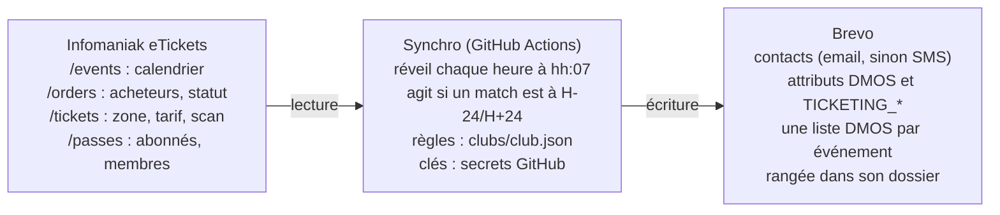

# Intégration billetterie Infomaniak → Brevo : guide de réplication

Ce guide explique comment brancher une nouvelle organisation sur la synchro, sans programmation. Les règles détaillées sont dans [`INTEGRATION.md`](INTEGRATION.md).

## Vue d'ensemble

La synchro lit toute la billetterie Infomaniak d'une organisation (commandes, billets, abonnements) et met à jour Brevo :
- les contacts ;
- les attributs d'achat et de présence ;
- une liste par événement, nommée selon le référentiel DMOS.

Elle tourne en production pour les Pully Lausanne Foxes depuis le 10.10.2026 (434 contacts, 11 listes) et pour les Lions de Genève depuis le 11.10.2026 (boutiques fan + VIP, 510 contacts, 10 listes).

**Quand elle tourne** : un workflow GitHub se réveille toutes les heures. Il ne synchronise que si un match de l'organisation atteint l'un de ces deux moments :
- **H-24** : les acheteurs sont dans Brevo la veille du match ;
- **H+24** : les scans sont définitifs, donc la présence, `DERNIER_MATCH` et `DERNIER_IMPORT` sont à jour.

Une synchro répétée ne change rien : la relancer n'est jamais risqué.

**Où ça vit** : ce dépôt, indépendant du FanLab. Une organisation = un fichier de configuration `clubs/<club>.json` + 3 secrets GitHub. Le code est commun : répliquer ne demande que de la configuration.

**Sécurité** :
- aucune clé dans le dépôt, seulement dans les secrets GitHub ;
- aucun email ni téléphone dans les journaux ;
- aucun export de billetterie (`.xlsx`, `.csv`) versionné.

Seul le workflow GitHub détient les clés. Infomaniak n'est jamais modifié : Brevo est le seul système écrit.

## Prérequis

Avant de commencer, réunir ces accès côté organisation et côté C'mon Sports.

| Accès | Pourquoi | Qui |
| --- | --- | --- |
| Manager Infomaniak de l'organisation, avec droits billetterie | créer la clé boutique et le jeton API | organisation (ou C'mon Sports avec délégation) |
| Compte Brevo de l'organisation, droits admin | clé API, attributs, dossiers | organisation |
| Ce dépôt GitHub, droits admin | secrets, variable, lancement des workflows | C'mon Sports |
| Référentiel DMOS (Notion) | code club, codes adversaires, noms de dossiers | C'mon Sports |
| Calendrier de la saison et liste des tarifs / zones | codes adversaires, correspondances de tarifs | organisation |

Il faut aussi décider avec l'organisation :
- la saison en cours (ex. `2026-2027`) ;
- le code club DMOS (ex. `FOXES`) ;
- les valeurs de `SOURCE_ACQUISITION` : `Billetterie` pour les acheteurs, `Business Engagement` pour les événements partenaires.

## Étape 1 : clés et secrets

L'API Infomaniak demande **deux** clés. La clé boutique seule ne lit rien, même pas la liste des événements : l'API répond « missing credential or Authorization ».

1. **Clé boutique Infomaniak** : Manager → Billetterie → Boutique / Mise en ligne → Accès API → générer une clé **avec droits de vente**. Elle est envoyée dans l'en-tête `key`.
2. **Jeton API du compte Manager** : Mon profil → Développeur → Jetons API → jeton pour « etickets ». Le compte doit avoir accès à la billetterie de l'organisation. Le jeton est envoyé en `Authorization: Bearer <jeton>`.
3. **Clé API Brevo** : Brevo → SMTP & API → Clés API. Si le compte limite les appels à certaines IP (« Authorized IPs »), désactiver ce filtre pour cette clé : les machines GitHub changent d'adresse.
4. **Secrets GitHub** : dépôt → Settings → Secrets and variables → Actions → onglet *Secrets* → *New repository secret*. Un secret par clé, nommé avec le code du club en majuscules :

| Secret | Contenu |
| --- | --- |
| `INFOMANIAK_API_KEY_<CLUB>` | clé boutique |
| `INFOMANIAK_TOKEN_<CLUB>` | jeton API Manager |
| `BREVO_API_KEY_<CLUB>` | clé API Brevo |

`<CLUB>` = le nom du fichier de config en majuscules (`clubs/lions.json` → `INFOMANIAK_API_KEY_LIONS`).

**Organisation avec deux boutiques** (ex. Lions : billetterie fan et billetterie VIP) : les deux
sont lues ensemble, pour que les totaux, `TICKET_STATUT` et `DERNIER_MATCH` couvrent toutes les
commandes. Ne jamais faire une synchro par boutique : la seconde écraserait les totaux de la
première pour les contacts présents dans les deux.
- config : `"infomaniak": {"extra_shops": ["VIP"]}` ;
- secret `INFOMANIAK_API_KEY_<CLUB>_VIP` (clé de la boutique VIP) ; noms acceptés aussi :
  `INFOMANIAK_FAN_KEY_<CLUB>` pour la boutique principale et `INFOMANIAK_VIP_KEY_<CLUB>` pour la VIP
  (noms utilisés par les Lions) ;
- secret `INFOMANIAK_TOKEN_<CLUB>_VIP` seulement si la boutique VIP dépend d'un autre compte
  Manager (sinon le jeton du club est utilisé) ;
- une commande ou un abonnement renvoyé par les deux boutiques n'est compté qu'une fois
  (`duplicates_skipped` dans le rapport) ; `test`, `probe` et `schema` affichent chaque boutique.

Ne jamais coller une clé dans un fichier, un ticket ou un message. Si c'est arrivé, la régénérer et mettre à jour le secret.

## Étape 2 : préparer Brevo

La synchro crée seule ses attributs techniques (`TICKETING_*`, `DERNIER_MATCH`, `DERNIER_IMPORT`). Elle ne crée jamais les attributs du référentiel DMOS de type **Catégorie**.

Les créer à la main (Contacts → Paramètres → Attributs de contact). Les libellés d'options doivent être exactement ceux ci-dessous ; seuls les majuscules et les accents sont ignorés.

| Attribut | Type | Options | Rempli avec |
| --- | --- | --- | --- |
| `TICKET_STATUT` | Catégorie | `NEW`, `ONBOARDED`, `REGULAR` | abonné de la saison = REGULAR, sinon 1 / 2 / 3+ matchs achetés |
| `CATEGORIE_PLACE` | Catégorie | les zones Infomaniak de l'organisation (Foxes : `Places assises`, `Zone 1`, `VIP`) | zone du dernier match acheté |
| `CATEGORIE_TARIF` | Catégorie | `Plein`, `Réduit`, `Enfant`, `Famille`, `Membre`, `VIP`, `Gratuit` | tarif du dernier match, regroupé via `tarif_mapping` |
| `SOURCE_ACQUISITION` | existant | `Billetterie`, `Business Engagement` | nouveaux contacts et contacts sans source |
| `OPT_IN` | existant | `YES` | nouveaux contacts (dérogation DMOS validée le 10.10.2026, valable pour toutes les organisations) |

Pour connaître les zones et tarifs réels d'une organisation avant de créer les options, lancer le mode `schema` (étape 4). Il liste les valeurs de `zone_name` et `category_name` sans aucune donnée personnelle.

**Dossiers** : la synchro range les listes dans `Billetterie <saison>`, `Abonnement`, `Business Engagement` et `Members & Staff`.
- Elle reconnaît un dossier existant même si son nom diffère légèrement (casse, accents, préfixe).
- Elle ne crée un dossier que s'il en manque un.
- Si l'organisation utilise d'autres noms, les indiquer dans la config (`lists_folder` / `folders`) avant la première synchro.

**Automations** : mettre en pause celles qui se déclenchent sur `DERNIER_IMPORT` ou sur l'entrée dans une liste, jusqu'au contrôle de la première synchro.

## Étape 3 : configurer l'organisation

1. Copier `clubs/foxes.json` en `clubs/<club>.json` (nom court en minuscules, ex. `lions`) et l'adapter.
2. Dans `.github/workflows/sync.yml`, ajouter `<club>` à la liste `options` du lancement manuel. C'est tout ce qu'il faut pour les modes de vérification.

L'ajout à la matrice des passages automatiques (`'["foxes"]'` → `'["foxes", "<club>"]'`) vient seulement à l'étape 5.

| Champ | Rôle | Foxes | À adapter |
| --- | --- | --- | --- |
| `club` | nom affiché dans les rapports | `Pully Lausanne Foxes` | oui |
| `event_lists.club_code` | code DMOS dans les noms de listes (obligatoire) | `FOXES` | oui |
| `event_lists.club_keywords` | mots qui désignent l'organisation dans les noms d'événements | défaut `foxes`, `pully` | **oui, sinon aucun match n'est reconnu** |
| `event_lists.season` | saison synchronisée | `2026-2027` | chaque saison |
| `event_lists.opponent_codes` | nom d'adversaire → code DMOS | `Lions de Genève` → `LIONS`… | oui, validés avec l'organisation |
| `event_lists.event_types` | mot-clé → type forcé (`partenaire`, `ignorer`, `camp`…) | `foxes night` → `partenaire` | oui |
| `event_lists.event_date_overrides` | corrige une date fausse et non modifiable dans Infomaniak | Starwings 16.01.26 → 2027-01-16 | si besoin |
| `event_lists.folders` / `lists_folder` | noms de dossiers Brevo par type | défauts DMOS | si l'organisation a d'autres noms |
| `ticket_attributes.tarif_mapping` | mot du tarif Infomaniak → option `CATEGORIE_TARIF`, dans l'ordre (le premier qui correspond gagne) | `offert` → `Gratuit`, `non membre` → `Plein` avant `membre` → `Membre`… | oui, d'après le mode `schema` |
| `ticket_attributes.place_mapping` | mot de la zone → option `CATEGORIE_PLACE` (sans correspondance : zone telle quelle) | `vip` → `VIP` | oui |
| `brevo.acquisition_value` / `partner_acquisition_value` | valeurs de `SOURCE_ACQUISITION` | `Billetterie` / `Business Engagement` | rarement |
| `brevo.list_ids` | liste globale où mettre tous les acheteurs | vide | optionnel |
| `infomaniak.passes_path` | abonnements et cartes de membre | `/passes` | non |
| `schedule` | H-24 / H+24, fenêtre de 12 h (`lookback_minutes` 720), fuseau | `Europe/Zurich` | rarement |

Le fichier ne contient **jamais** de clé : le bloc `secrets` ne liste que les noms des secrets GitHub.

## Étape 4 : vérifier avant toute écriture

Tout se lance depuis GitHub : onglet *Actions* → *Sync billetterie -> Brevo* → *Run workflow*, puis choisir le club et le mode. Les quatre premiers modes n'écrivent rien et n'affichent aucun email ni téléphone.

| Ordre | Mode | Ce qu'il vérifie | Résultat attendu |
| --- | --- | --- | --- |
| 1 | `test` | les clés Infomaniak lisent événements et commandes | `success: true`, nombre d'événements, `orders_readable: true` |
| 2 | `probe` (si le test échoue) | chaque façon d'envoyer le jeton, sur `/events` et `/orders` | au moins une ligne `ok: true` |
| 3 | `schema` | les champs renvoyés et les valeurs de statuts, zones et tarifs | listes de zones et tarifs pour l'étape 2 et `tarif_mapping` |
| 4 | `dry-run` | toute la synchro, en lecture seule | rapport complet, aucun avertissement bloquant |
| 5 | `sync` | la synchro réelle | étape 5 |

**Lire le rapport du dry-run** (en bas du journal, bloc JSON) :

- `event_types` : chaque événement et son type (`match`, `camp`, `abonnement`, `membre`, `partenaire`, `autre`, `ignorer`).
  - Un match classé `autre` signale des `club_keywords` incomplets.
  - Un événement factice (comme « Les matchs arrivent bientôt ! ») : l'ajouter à `event_types` comme `ignorer`.
- `event_lists.lists` : noms de listes prévus, nombre de contacts, et `list_id` (liste déjà existante) ou `null` (liste à créer). Vérifier chaque code adversaire.
- `event_lists.folders` : `id` trouvé ou `null` (dossier à créer). Un `null` sur un dossier qui existe déjà signifie que son nom est trop différent : le régler dans `folders`.
- `new_contacts`, `existing_contacts`, `source_filled`, `last_import_updated`, `ticket_attributes` : ordres de grandeur à valider avec l'organisation.
- `warnings` :
  - « Code adversaire déduit automatiquement » → ajouter le code ;
  - « Attribut absent de Brevo » → créer l'attribut ;
  - « valeur sans option Brevo » → ajouter l'option ou une correspondance ;
  - « A DEFINIR » et conflits SMS → normaux.

Corriger, puis relancer le dry-run jusqu'à obtenir un rapport propre.

## Étape 5 : première synchro et passage en automatique

1. Vérifier que les automations Brevo concernées sont en pause.
2. Lancer le mode `sync`. Compter environ 5 minutes pour ~450 contacts : sans liste globale, chaque contact est écrit un par un, puis importé dans ses listes.
3. Contrôler dans Brevo :
    - l'historique des imports est terminé et les listes ont les effectifs du rapport ;
    - 2 ou 3 fiches connues portent `SOURCE_ACQUISITION`, `DERNIER_MATCH`, `DERNIER_IMPORT`, `TICKET_STATUT`, `CATEGORIE_*` et `TICKETING_*` ;
    - aucun dossier en double. En cas de doublon : régler le nom du dossier dans `folders`, déplacer les listes et supprimer le doublon. La synchro retrouve une liste déplacée par son nom.
4. Réactiver les automations.
5. Variable `SYNC_ENABLED` = `true` : à créer une seule fois pour tout le dépôt (Settings → Secrets and variables → Actions → onglet *Variables*). Sans elle, les passages automatiques ne font qu'un dry-run.
    - Elle est déjà active depuis les Foxes.
    - Pour un nouveau club, ce qui le met en automatique est son ajout à la matrice de `sync.yml` (`'["foxes", "<club>"]'`). À faire maintenant, après la première synchro contrôlée.
6. Au premier passage H+24, vérifier dans l'onglet *Actions* le run planifié du club et quelques fiches de spectateurs.

Un échec (clé invalide, API indisponible) fait échouer le workflow, et GitHub envoie un email au propriétaire du dépôt.

## Référence : règles appliquées

Ces règles sont communes à toutes les organisations ; le détail complet est dans [`INTEGRATION.md`](INTEGRATION.md).

**Lecture Infomaniak**

- Commandes (`/orders`) : seules `paid` et `free` comptent ; `unbooked`, `cancelled` et `refunded` sont ignorées.
- Billets (`/tickets`) : chaque billet est rattaché à sa commande. Une commande sur deux événements compte comme deux achats.
  - `scanned` = présent ;
  - `valid` = non scanné ;
  - `cancelled` = ignoré.
- Abonnements et cartes de membre (`/passes`) : le contact est le **détenteur**. Sa fiche n'a pas d'email : on reprend celui de l'acheteur s'il s'agit de la même personne, sinon le détenteur est identifié par son téléphone.

**Contacts et attributs**

- Identifiant : email, sinon téléphone (`SMS`, format international). Un numéro déjà porté par un autre contact n'est pas écrit (conflit SMS).
- `SOURCE_ACQUISITION` : rempli seulement s'il est vide. Il vaut `Business Engagement` si le premier achat est un événement partenaire, sinon `Billetterie`.
- `OPT_IN` = `YES` pour les nouveaux contacts.
- `DERNIER_MATCH` : dernier match **joué** où le contact est venu ou a acheté.
- `DERNIER_IMPORT` : déclencheur des automations d'après-match. Il change seulement après le match, quand les achats ou le dernier match changent.
- Places d'abonnés et de membres pré-générées par Infomaniak : elles comptent pour un match seulement si elles sont scannées.
- Un billet acheté mais non scanné sur un match joué = absent.
- Montants :
  - une commande gratuite ou un abonnement « Gratuit » = 0 CHF ;
  - `TICKETING_LAST_ORDER_AMOUNT`, `TICKETING_AVG_BASKET` et `TICKETING_TOTAL_SPENT` sont calculés sur tout l'historique.
- NPA, date de naissance : remplis seulement s'ils sont vides dans Brevo.

**Listes et dossiers (référentiel DMOS)**

| Type d'événement | Liste | Dossier |
| --- | --- | --- |
| Match | `CMON-<CLUB>-<ADV>-<AAAAMMJJ>` | `Billetterie <saison>` |
| Camp, autre | `CMON-<CLUB>-<Description>-<AAAAMMJJ>` | `Billetterie <saison>` |
| Événement partenaire | `CMON-<CLUB>-<Description>-<AAAAMMJJ>` | `Business Engagement` |
| Abonnement | `CMON-Abonnes-<saison>` | `Abonnement` |
| Abonnement VIP | `CMON-Abonnes-VIP-<saison>` (séparée, VIP absents de la liste classique) | `Business Engagement` |
| Invité VIP (billet zone ou tarif VIP sur un match, sans abonnement VIP) | `CMON-Invites-VIP-<saison>`, en plus de la liste du match ; source `Business Engagement` si premier achat | `Business Engagement` |
| Carte de membre | `CMON-Membres-<saison>` | `Members & Staff` |

Une liste de match contient les acheteurs et les présents, pas toutes les places pré-générées. Une date est obligatoire dans le nom d'une liste : un événement « A DEFINIR » n'a sa liste qu'une fois daté.

## Pièges rencontrés avec les Foxes

Tous ont été réglés, dans le code ou dans la configuration des Foxes. Ils restent utiles pour lire un journal d'erreur.

| Symptôme | Cause | Solution |
| --- | --- | --- |
| `missing credential or Authorization` (400) | la clé boutique seule ne suffit pas | créer le jeton API Manager, secret `INFOMANIAK_TOKEN_<CLUB>` |
| `Authorization is not valid` (401) | clé boutique envoyée comme jeton, ou jeton d'un compte sans accès billetterie | jeton du bon compte ; vérifier avec `probe` |
| Secrets vides dans le journal | secret créé dans un environnement ou mal nommé | onglet *Secrets* du dépôt, nom exact avec le code club |
| Camp nommé `CMON-FOXES-12-20261012` | la date du nom prise pour un adversaire | corrigé : seuls les matchs reçoivent un code adversaire |
| « Carte membre » sans liste | type non reconnu | corrigé : type `membre` → `CMON-Membres-<saison>` |
| Date de match fausse dans Infomaniak (Starwings « 16.01.26 ») | saisie erronée non modifiable | `event_date_overrides` |
| Tarif « sans option Brevo » (ex. `Pass ENBL`) | tarif absent de `tarif_mapping` | ajouter une correspondance ou une option |
| `Missing listIds or newList` (400) à la première synchro | l'import groupé Brevo exige une liste | corrigé : écriture un par un sans liste globale |
| Second dossier `Business Engagement` créé | nom du dossier existant légèrement différent | corrigé : reconnaissance tolérante ; listes cherchées dans tout le compte |
| Aucun passage automatique après création du dépôt | GitHub met du temps à enregistrer une planification | vérifier les runs `schedule` ; sinon désactiver puis réactiver le workflow |
| Match d'une organisation classé `autre` (Lions : « Landau Lions », « Lugano Tigers Lions ») | `club_keywords` trop court : l'adversaire contient aussi le mot | mot-clé plus précis (`lions de geneve`) |
| Code adversaire déduit avec la compétition (« SL Benfica \| FIBA Europe Cup ») | séparateur « \| » dans les noms Infomaniak | corrigé : « \| » sépare comme un tiret ; ajouter le code dans `opponent_codes` |
| `SOURCE_ACQUISITION has no option 'Business Engagement'` | libellé différent dans le Brevo de l'organisation | ajouter l'option dans Brevo (référentiel DMOS : `Business Engagement`), ou à défaut régler `brevo.partner_acquisition_value` |
| Liste abonnés (25) ≠ abonnés avec attribut (27) | les 2 VIP sont dans leur propre liste | normal : filtrer sur `TICKETING_SEASON_TICKET` pour le total |

## Checklist de réplication

- [ ] Accès réunis : Manager Infomaniak, Brevo admin, GitHub admin, référentiel DMOS
- [ ] Code club, saison, codes adversaires validés avec l'organisation
- [ ] Clé boutique Infomaniak (droits de vente) créée
- [ ] Jeton API Manager créé (compte avec accès billetterie)
- [ ] Clé API Brevo créée, filtre IP désactivé pour elle
- [ ] Secrets `INFOMANIAK_API_KEY_<CLUB>`, `INFOMANIAK_TOKEN_<CLUB>`, `BREVO_API_KEY_<CLUB>` ajoutés (+ `INFOMANIAK_API_KEY_<CLUB>_VIP` si seconde boutique)
- [ ] `clubs/<club>.json` créé (club_code, club_keywords, saison, adversaires, types d'événements)
- [ ] Club ajouté aux `options` du lancement manuel dans `sync.yml`
- [ ] Mode `test` réussi
- [ ] Mode `schema` lu : zones et tarifs notés
- [ ] Attributs `TICKET_STATUT`, `CATEGORIE_PLACE`, `CATEGORIE_TARIF` créés avec leurs options ; `tarif_mapping` et `place_mapping` ajustés
- [ ] Dry-run propre : types d'événements, listes, dossiers trouvés, aucun avertissement bloquant
- [ ] Automations Brevo en pause
- [ ] Mode `sync` lancé et contrôlé dans Brevo (listes, fiches, pas de dossier en double)
- [ ] Automations réactivées
- [ ] Club ajouté à la matrice de `sync.yml` (passages automatiques)
- [ ] Premier passage H+24 vérifié dans l'onglet *Actions*
